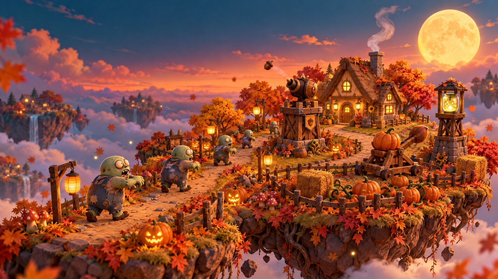
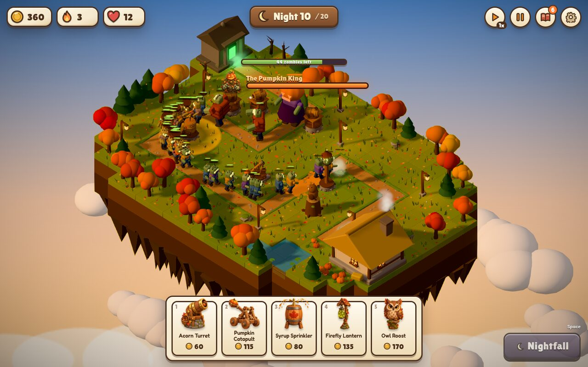
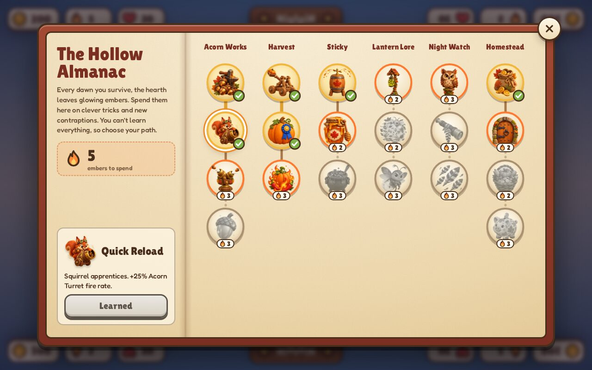
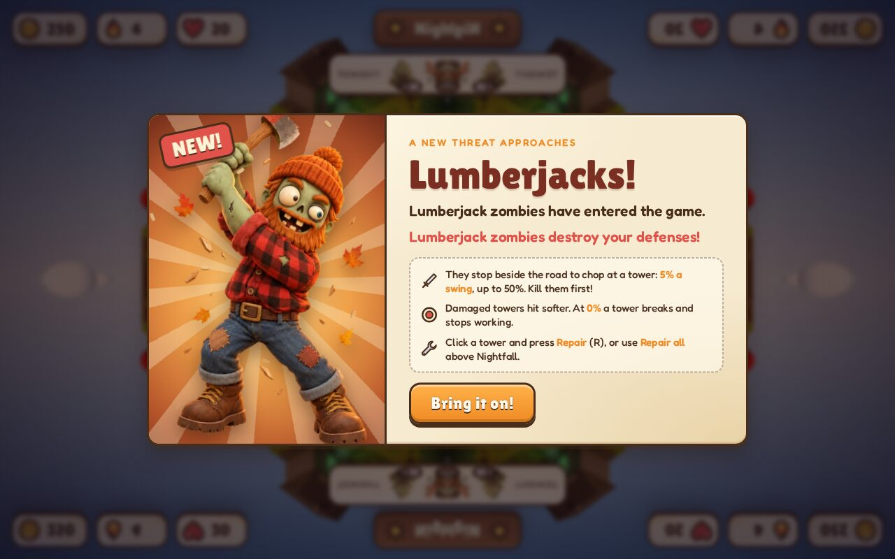

# Lantern Hollow

*A cozy autumn zombie defense.*



Every night, sleepy zombies wander out of the old crypt and shuffle down the road toward your cottage. Build acorn turrets, pumpkin catapults, syrup sprinklers, firefly lanterns and owl roosts along the way, and survive twenty nights to save the soup.



## Play it locally

You need [Node.js](https://nodejs.org/) 20 or newer.

```bash
npm install
npm run dev
```

Then open http://localhost:5173 and click anywhere to start the music.

## How to play

- **Build:** pick a tower from the bar at the bottom (or press `1`–`5`) and click the grass beside the road.
- **Nightfall:** zombies only come when you call them. Press **Nightfall** (or `Space`) when you're ready.
- **Gold** builds towers, **embers** (earned each dawn) buy research in the **Almanac**, and **hearts** are your cottage's health.
- **Click a tower** to change its targeting, sell it, or repair it. Upgrades unlock on **night 10**.
- **Camera:** `Q`/`E` rotate, mouse wheel zooms, right-drag or `WASD` pans, `Home` resets the view.
- `F` changes game speed, `P` pauses, `B` opens the Almanac, `T` opens the Trophy Room, `Esc` cancels.
- **On a phone:** drag to look around, pinch to zoom, use the arrow buttons to turn the island, and tap twice to build (once to preview, once to place). On iPhone, **Share → Add to Home Screen** plays it fullscreen.
- **Trophies:** 23 to collect, from surviving milestones and flawless runs to finishing rich (or letting the zombies into the soup). They stay on your shelf across games.

### Things to watch out for

- **The Pumpkin King** rises on nights 10 and 20. Owls and catapults hurt him most.
- **Lumberjacks** show up from night 11 and stop to chop at your towers. Damaged towers hit softer, and a tower at 0% explodes and has to be rebuilt. Repairs cost double while the invasion is on.




## Testing notes

All feedback is welcome. Please open an issue for bugs, balance thoughts (too easy, too hard, a tower that feels useless) or anything that looks or sounds off. Mentioning your browser and roughly how far you got helps a lot.

- Graphics quality adjusts itself if the game runs slowly. You can also set it in **Settings** (the gear).
- Every sound and all the music is synthesized live in your browser. You can audition them at `/audio-lab.html`.
- Your progress saves at each dawn. **Continue** on the title screen picks up where you left off.

## For developers

```bash
npm test           # unit tests (vitest)
npm run typecheck  # TypeScript
npm run build      # production build into dist/
```

Built with [Three.js](https://threejs.org/), [postprocessing](https://github.com/pmndrs/postprocessing), [N8AO](https://github.com/N8python/n8ao), TypeScript and Vite. All 3D models are built in code; the painted art was made with OpenArt.
